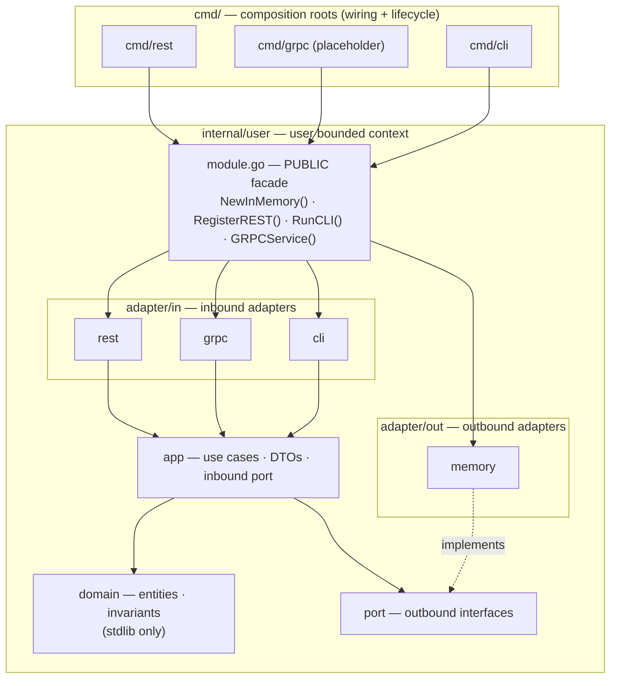
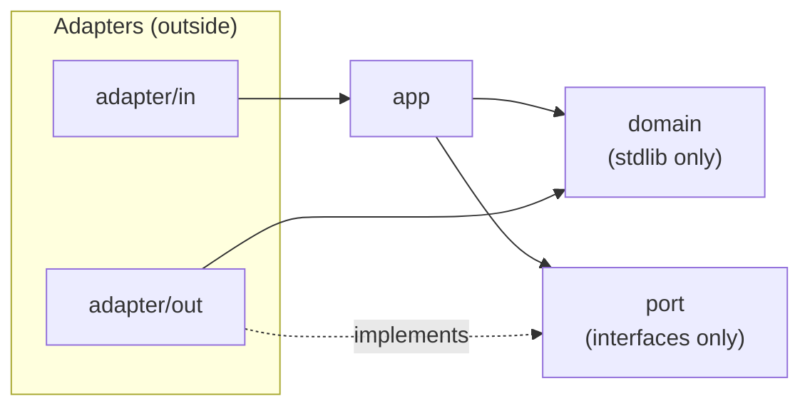
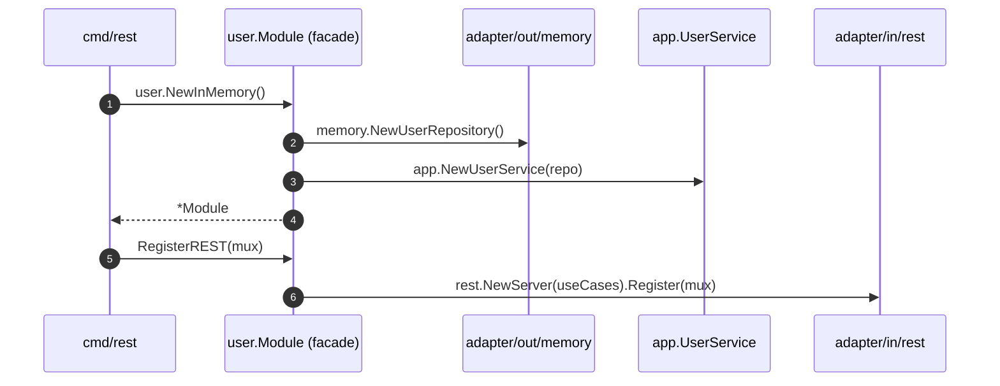
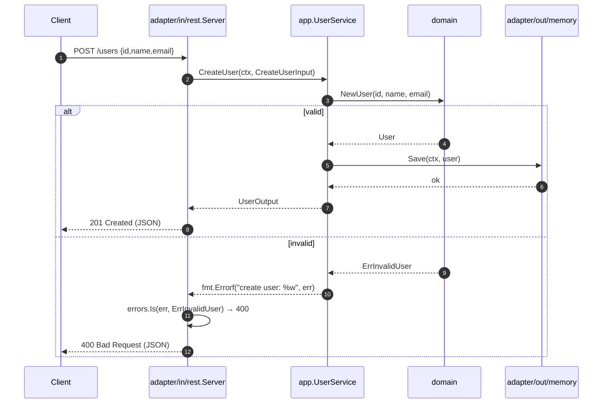
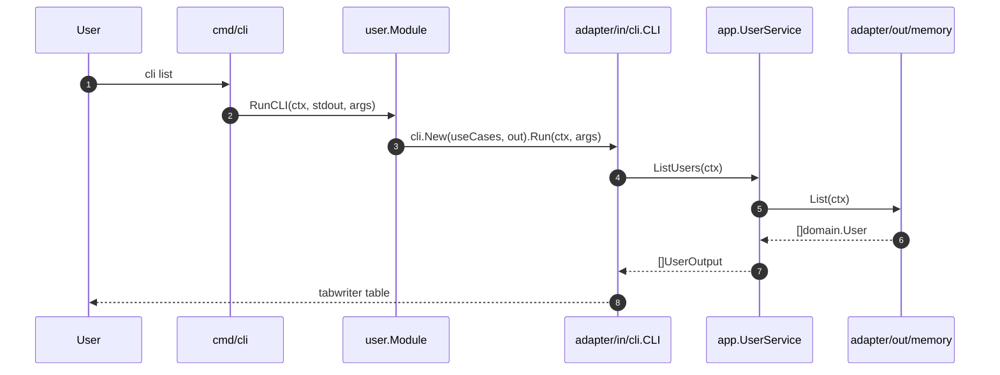

# go-std

A reference Go application structured as a **modular monolith** using **DDD + Hexagonal
Architecture (Ports & Adapters)**. One core, three delivery mechanisms — **REST**, **gRPC**
(placeholder), and **CLI** — each wired independently by a command root while sharing the
same use cases.

## Requirements

- Go 1.25+
- Optional tooling: `golangci-lint`, `gofumpt` — install with `make install-tools`

## Quick start

```sh
make build          # compile every command into bin/
make test           # run all tests with -race
make run CMD=rest   # start the REST API on :8080
make run CMD=cli ARGS="list"
```

REST example:

```sh
curl -X POST localhost:8080/users \
  -d '{"id":"u1","name":"Ada","email":"ada@example.com"}'
# {"id":"u1","name":"Ada","email":"ada@example.com"}

curl localhost:8080/users/u1
curl localhost:8080/users
```

CLI example (each command selects a module by name):

```sh
make run CMD=cli ARGS="user create -id u1 -name Ada -email ada@example.com"
make run CMD=cli ARGS="user list"
make run CMD=cli ARGS="order place -id o1 -customer c1 -product p1 -name Widget -price 100 -currency USD -qty 10"
make run CMD=cli ARGS="order confirm o1"
```

## Project structure

```
cmd/
  rest/main.go                 # composition root: REST server
  grpc/main.go                 # composition root: gRPC server (placeholder)
  cli/main.go                  # composition root: CLI
internal/
  user/                        # the "user" bounded context (module)
    module.go                  # PUBLIC facade — the module's only entrypoint
    domain/                    # entities, value objects, errors (stdlib only)
    app/                       # use cases, DTOs, inbound port interface
    port/                      # outbound port interfaces
    adapter/
      in/rest/                 # inbound adapter: HTTP + JSON
      in/grpc/                 # inbound adapter: gRPC (placeholder)
      in/cli/                  # inbound adapter: command line
      out/memory/              # outbound adapter: in-memory repository
  order/                       # the "order" bounded context — richer DDD example
    module.go                  # PUBLIC facade: NewInMemory(out)
    domain/                    # Order aggregate, Money/Quantity VOs, events, DiscountPolicy
    app/                       # OrderService use cases, DTOs, inbound port
    port/                      # OrderRepository, EventPublisher, Clock
    adapter/
      in/rest/                 # inbound adapter: HTTP + JSON
      in/grpc/                 # inbound adapter: gRPC (placeholder)
      in/cli/                  # inbound adapter: command line
      out/memory/              # outbound adapter: in-memory repository
      out/eventlog/            # outbound adapter: writes domain events to an io.Writer
      out/systemclock/         # outbound adapter: system clock
```

The `user` module is the minimal reference slice. The `order` module shows a fuller DDD
model: an `Order` aggregate root guarding its invariants, `Money`/`Quantity` value objects,
domain events (`order.placed`, `order.line_added`, `order.confirmed`, `order.cancelled`),
and a `DiscountPolicy` domain service — with a `Clock` port so use cases stay deterministic.

## Architecture

Each module is a self-contained hexagon. `cmd/` composes module facades; adapters on the
outside talk to the application core through ports; the core never depends on the outside.



### Hexagonal dependency rule

Imports point inward only. `domain/` depends on nothing; `app/` depends on `domain/` and
`port/`; adapters depend on the core; ports are implemented by outbound adapters.



### Module boundaries

A module's only public surface is its facade `module.go`. `cmd/` and other modules must not
import a module's `domain`, `app`, `port`, or `adapter` packages — they go through the
facade. Cross-module layer imports are rejected by `make lint` (depguard rules in
`.golangci.yml`); the remaining boundaries are checked in review (see `AGENTS.md`). Nesting
each module's layers under `internal/<module>/internal/` would make it fully
compiler-enforced. **When adding a module, register it in the depguard rules.**

## Request flow

### Startup — wiring a module



### REST request — create a user (happy + error path)



### CLI command — list users



### gRPC

The gRPC transport is a documented placeholder. Implementing it requires a `.proto`
definition, generated Go code, and the `google.golang.org/grpc` dependency. The generated
server belongs in `internal/user/adapter/in/grpc` and must delegate to the same
`app.UserUseCases` interface as REST and CLI; register it in `cmd/grpc` through the module
facade (`user.NewInMemory().GRPCService()`).

## Adding to the app

- **A feature inside `user`**: follow the slice order `domain → port → app →
  adapter/out → adapter/in → facade entrypoint → wire in cmd/`. Use `/scaffold` in opencode
  for the guided recipe.
- **A new bounded context**: create `internal/<module>/` with the same layout, expose a
  `module.go` facade, and compose it in the `cmd/*` roots. The `order` module is a worked
  example. Register the new module in the depguard rules in `.golangci.yml`.

Every transport must call the same application use case — never duplicate logic per
transport.

## Commands

| Task         | Command                                       |
| ------------ | --------------------------------------------- |
| Build        | `make build`                                  |
| Test         | `make test`                                   |
| Coverage     | `make cover`                                  |
| Lint         | `make lint`                                   |
| Format       | `make fmt`                                    |
| Vet          | `make vet`                                    |
| Tidy modules | `make tidy`                                   |
| Tools setup  | `make install-tools`                          |
| Run REST     | `make run CMD=rest`                           |
| Run gRPC     | `make run CMD=grpc`                           |
| Run CLI      | `make run CMD=cli ARGS="user list"`           |

Definition of done: `make build && make test && make lint && make vet` all green.

## Development process (agentic, plan-driven)

Work is driven from a **written requirement** to a **written plan** to **verified code**.
Requirements live in `docs/requirements/`, plans in `docs/plans/`; both are committed and
are the audit trail of why the code looks the way it does. See `docs/README.md` for the
full convention.

```
docs/requirements/<name>.md   # 1. the what — human-written, small and testable
        │  /plan <name>
        ▼
docs/plans/<name>.md          # 2. the how — agent-written, anchored in real code
        │  /implement <name>
        ▼
code + green DoD              # 3. the code — agent-built, verified step by step
```

### The loop, for any developer

1. **Write a requirement.** Copy `docs/requirements/_TEMPLATE.md` to
   `docs/requirements/<name>.md` (kebab-case, e.g. `order-export-csv.md`) and fill in the
   Problem, Solution, and — most importantly — the **Acceptance criteria** as observable,
   testable outcomes. Requirements describe behavior, never implementation.
2. **Plan it.** Run `/plan <name>`. The planning agent explores the codebase, anchors the
   design in the real modules (copying `order` for anything non-trivial), and writes
   `docs/plans/<name>.md` with ordered, file-by-file steps, each naming a verification
   command. **Review the plan before implementing** — this is where design changes are cheap.
3. **Implement it (TDD).** Run `/implement <name>`. The agent works the plan's checklist in
   order, one **red → green → refactor** cycle per step: it writes the failing test first,
   makes it pass with the smallest change, tidies up, and runs each step's verification. It
   keeps the plan file in sync when reality diverges, and finishes with the full definition
   of done plus `test-writer` and `go-reviewer` as independent checkpoints.
4. **Commit it.** Run `/commit` for a Conventional Commit scoped to the module
   (e.g. `feat(order): add CSV export subcommand`).

Worked example: `docs/requirements/order-export-csv.md` →
`docs/plans/order-export-csv.md` (marked `done`).

### Rules that keep the process honest

- **Plans are committed.** They explain intent that code cannot.
- **Test first.** Every step starts with a failing test (red); implementation makes it pass
  (green); refactor with the test green. No implementation code without a test that drives it.
- **Fix the plan first.** If a step is wrong, edit `docs/plans/<name>.md` (and note it under
  *Risks / open questions*) *before* letting the code diverge.
- **Verify every step.** A step is done only when its own verification command passes.
- **Manual or agentic, the bar is the same:** `make build && make test && make lint && make vet`.

### opencode assets

This repo ships opencode configuration so agents produce code that fits the architecture:

| Asset | Purpose |
| ----- | ------- |
| `AGENTS.md` | The conventions every agent must follow |
| `.opencode/skills/go-conventions/` | Module + hexagonal quick reference (loads while coding) |
| `.opencode/skills/project-onboarding/` | Guided tour of the repo for a new contributor |
| `.opencode/agents/go-reviewer.md` | Read-only architecture/code reviewer |
| `.opencode/agents/test-writer.md` | Writes table-driven stdlib tests |
| `.opencode/agents/doc-writer.md` | Writes godoc, package docs, READMEs |
| `.opencode/commands/plan.md` | `/plan` — requirement → committed plan |
| `.opencode/commands/implement.md` | `/implement` — plan → verified implementation |
| `.opencode/commands/scaffold.md` | `/scaffold` — add a feature or whole module |
| `.opencode/commands/review.md` | `/review` — review the current diff |
| `.opencode/commands/test.md` | `/test` — run, fix, and report coverage |
| `.opencode/commands/commit.md` | `/commit` — Conventional Commit for the diff |

New to the repo? Ask the agent to **onboard you** — the `project-onboarding` skill walks
through the structure, the build, the request flow, and the conventions in order.
