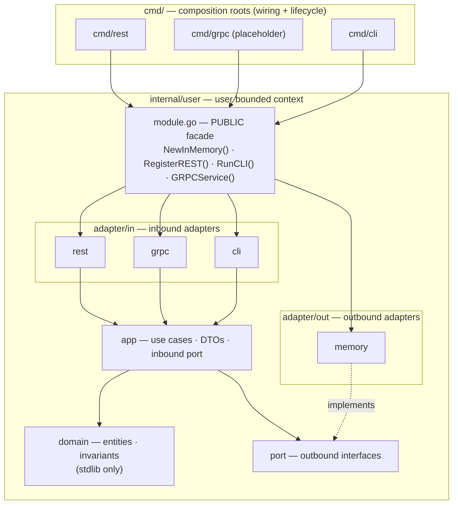
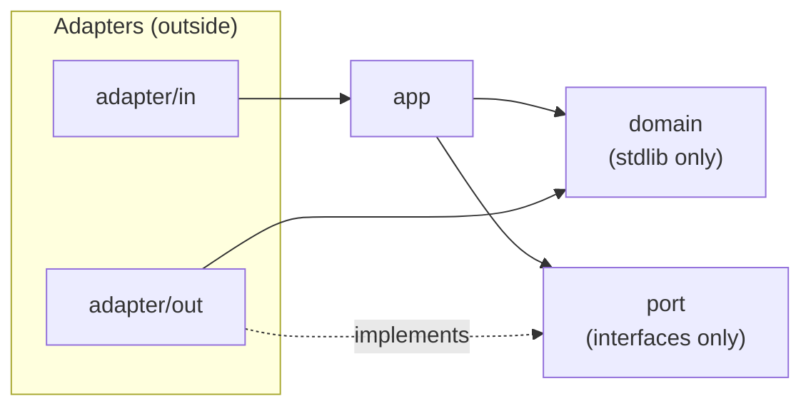
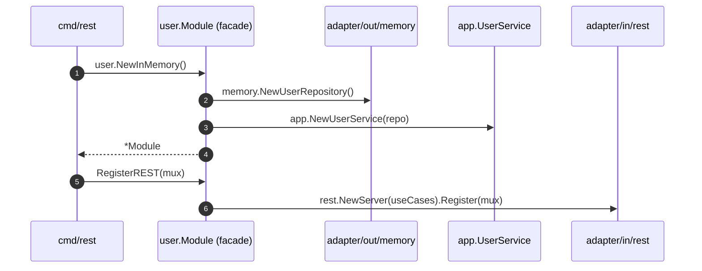
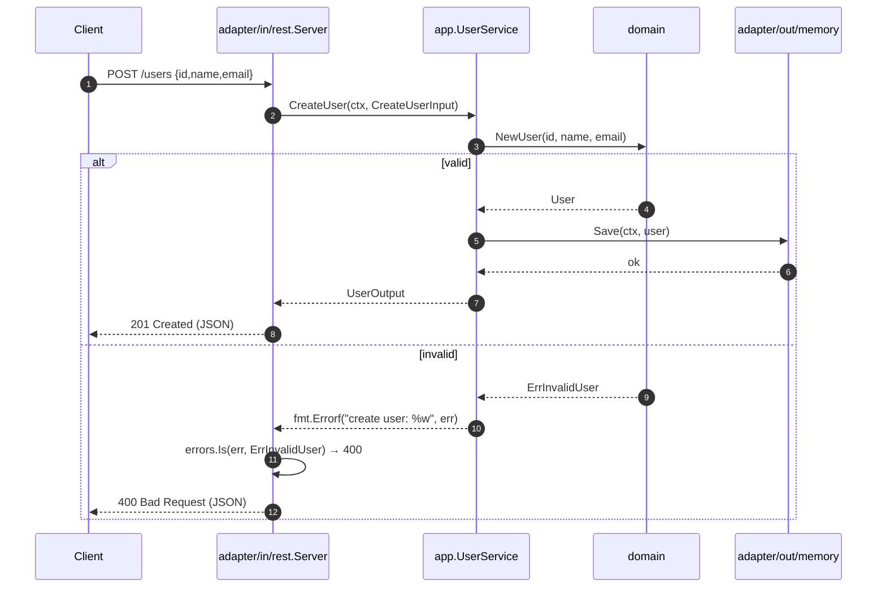
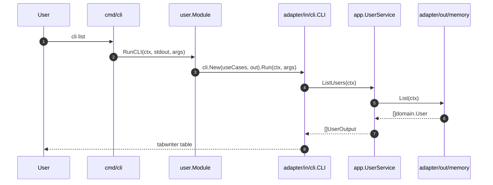

# go-std

A reference Go application structured as a **modular monolith** using **DDD + Hexagonal
Architecture (Ports & Adapters)**. One core, three delivery mechanisms — **REST**, **gRPC**
(placeholder), and **CLI** — each wired independently by a command root while sharing the
same use cases.

## Requirements

- Go 1.25+
- Optional tooling: `golangci-lint`, `gofumpt` — install with `make install-tools`

## Quick start

```sh
make build          # compile every command into bin/
make test           # run all tests with -race
make run CMD=rest   # start the REST API on :8080
make run CMD=cli ARGS="list"
```

REST example:

```sh
curl -X POST localhost:8080/users \
  -d '{"id":"u1","name":"Ada","email":"ada@example.com"}'
# {"id":"u1","name":"Ada","email":"ada@example.com"}

curl localhost:8080/users/u1
curl localhost:8080/users
```

CLI example (each command selects a module by name):

```sh
make run CMD=cli ARGS="user create -id u1 -name Ada -email ada@example.com"
make run CMD=cli ARGS="user list"
make run CMD=cli ARGS="order place -id o1 -customer c1 -product p1 -name Widget -price 100 -currency USD -qty 10"
make run CMD=cli ARGS="order confirm o1"
```

## Project structure

```
cmd/
  rest/main.go                 # composition root: REST server
  grpc/main.go                 # composition root: gRPC server (placeholder)
  cli/main.go                  # composition root: CLI
internal/
  user/                        # the "user" bounded context (module)
    module.go                  # PUBLIC facade — the module's only entrypoint
    domain/                    # entities, value objects, errors (stdlib only)
    app/                       # use cases, DTOs, inbound port interface
    port/                      # outbound port interfaces
    adapter/
      in/rest/                 # inbound adapter: HTTP + JSON
      in/grpc/                 # inbound adapter: gRPC (placeholder)
      in/cli/                  # inbound adapter: command line
      out/memory/              # outbound adapter: in-memory repository
  order/                       # the "order" bounded context — richer DDD example
    module.go                  # PUBLIC facade: NewInMemory(out)
    domain/                    # Order aggregate, Money/Quantity VOs, events, DiscountPolicy
    app/                       # OrderService use cases, DTOs, inbound port
    port/                      # OrderRepository, EventPublisher, Clock
    adapter/
      in/rest/                 # inbound adapter: HTTP + JSON
      in/grpc/                 # inbound adapter: gRPC (placeholder)
      in/cli/                  # inbound adapter: command line
      out/memory/              # outbound adapter: in-memory repository
      out/eventlog/            # outbound adapter: writes domain events to an io.Writer
      out/systemclock/         # outbound adapter: system clock
```

The `user` module is the minimal reference slice. The `order` module shows a fuller DDD
model: an `Order` aggregate root guarding its invariants, `Money`/`Quantity` value objects,
domain events (`order.placed`, `order.line_added`, `order.confirmed`, `order.cancelled`),
and a `DiscountPolicy` domain service — with a `Clock` port so use cases stay deterministic.

## Architecture

Each module is a self-contained hexagon. `cmd/` composes module facades; adapters on the
outside talk to the application core through ports; the core never depends on the outside.



### Hexagonal dependency rule

Imports point inward only. `domain/` depends on nothing; `app/` depends on `domain/` and
`port/`; adapters depend on the core; ports are implemented by outbound adapters.



### Module boundaries

A module's only public surface is its facade `module.go`. `cmd/` and other modules must not
import a module's `domain`, `app`, `port`, or `adapter` packages — they go through the
facade. This is a documented convention checked in review (see `AGENTS.md`); nesting each
module's layers under `internal/<module>/internal/` would make it compiler-enforced.

## Request flow

### Startup — wiring a module



### REST request — create a user (happy + error path)



### CLI command — list users



### gRPC

The gRPC transport is a documented placeholder. Implementing it requires a `.proto`
definition, generated Go code, and the `google.golang.org/grpc` dependency. The generated
server belongs in `internal/user/adapter/in/grpc` and must delegate to the same
`app.UserUseCases` interface as REST and CLI; register it in `cmd/grpc` through the module
facade (`user.NewInMemory().GRPCService()`).

## Adding to the app

- **A feature inside `user`**: follow the slice order `domain → port → app →
  adapter/out → adapter/in → facade entrypoint → wire in cmd/`. Use `/scaffold` in opencode
  for the guided recipe.
- **A new bounded context**: create `internal/<module>/` with the same layout, expose a
  `module.go` facade, and compose it in the `cmd/*` roots. The `order` module is a worked
  example.

Every transport must call the same application use case — never duplicate logic per
transport.

## Commands

| Task         | Command                                       |
| ------------ | --------------------------------------------- |
| Build        | `make build`                                  |
| Test         | `make test`                                   |
| Coverage     | `make cover`                                  |
| Lint         | `make lint`                                   |
| Format       | `make fmt`                                    |
| Vet          | `make vet`                                    |
| Tidy modules | `make tidy`                                   |
| Tools setup  | `make install-tools`                          |
| Run REST     | `make run CMD=rest`                           |
| Run gRPC     | `make run CMD=grpc`                           |
| Run CLI      | `make run CMD=cli ARGS="user list"`           |

Definition of done: `make build && make test && make lint && make vet` all green.

## Agentic development

This repo ships opencode configuration for agent-driven development:

- `AGENTS.md` — the conventions agents must follow
- `.opencode/agents/` — `go-reviewer`, `test-writer`, `doc-writer`
- `.opencode/commands/` — `/scaffold`, `/review`, `/test`
- `.opencode/skills/go-conventions/` — the module + hexagonal quick reference
